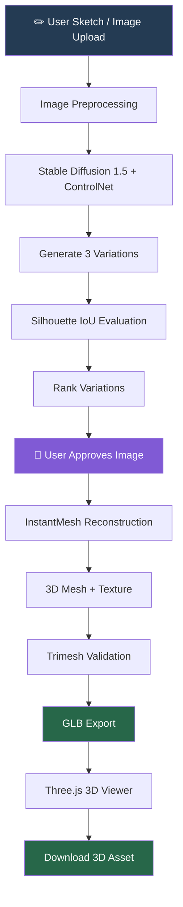

# ✦ PoofIt3D — From Sketch to 3D

\<p align="center">
&#x20; \
\</p>

\<h3 align="center">Your imagination starts with a sketch. We turn it into a 3D creation.\</h3>

\<p align="center">
&#x20; \<strong>Draw → Enhance → Approve → Generate → Explore → Export\</strong>
\</p>

\<p align="center">
&#x20; \
&#x20; \
&#x20; \
&#x20; \
\</p>

\<p align="center">
&#x20; \<strong>Team Sirius\</strong>\<br/>
&#x20; K. Akash · Kavish Bhatia · Keerthi H.
\</p>

---

## 🚀 What is PoofIt3D?

Turning a rough drawing into a usable 3D model traditionally requires modelling expertise, specialised software and significant time.

**PoofIt3D makes that process accessible.**

It transforms a hand-drawn sketch or uploaded image into a visually enhanced 2D concept, then reconstructs the approved concept into a textured, downloadable 3D asset.

Unlike a simple image generator, PoofIt3D combines sketch-conditioned image generation, an explainable sketch-fidelity selection layer, and image-to-3D reconstruction in one workflow.

**Our goal:** Preserve the user's original idea while making 3D creation easier and faster.

### ✨ The experience

1. **Sketch:** Draw directly on the canvas or upload an image.
2. **Enhance:** Generate three visually enhanced variations guided by the original sketch.
3. **Evaluate:** Rank generated variations using silhouette Intersection over Union (IoU).
4. **Approve:** Select the variation that best represents the intended design.
5. **Reconstruct:** Convert the approved image into a 3D mesh using InstantMesh.
6. **Export:** Inspect, rotate and download the textured `.glb` model.

---

## 🖼️ See what PoofIt3D creates

> The following are actual outputs from our successful end-to-end generation runs.

### Sketch-to-image results

Each example shows the original sketch and its three generated variations.

| Racecar | Person |
| :-----: | :----: |
|         |        |

| Camel | House |
| :---: | :---: |
|       |       |

### 🧊 Generated 3D assets

Four objects were successfully reconstructed and exported as textured GLB models.

| Object  | Vertices |  Faces | File size | Generation time |
| :------ | -------: | -----: | --------: | --------------: |
| Racecar |   10,453 | 14,336 |   1.13 MB |         88.51 s |
| Camel   |    7,406 | 10,616 |   1.23 MB |         72.70 s |
| Person  |    8,049 | 12,068 |   1.19 MB |         71.20 s |
| House   |   19,901 | 28,420 |   1.89 MB |         77.00 s |

**Download the actual 3D models:**

- [🏎️ Racecar — GLB](docs/results/racecar.glb)
- [🐪 Camel — GLB](docs/results/camel.glb)

You can inspect these files using [Online glTF Viewer](https://gltf-viewer.donmccurdy.com/) or import them into Blender.

**Test environment:** NVIDIA Tesla T4 GPU · InstantMesh Large · `grid_res=64`

---

## 🧠 How the system works

PoofIt3D uses a two-stage generative pipeline, supported by a separate quality evaluation and validation layer.

### System architecture



### Stage 1 — Sketch to enhanced image

**Technology:** Stable Diffusion 1.5 + ControlNet-Scribble

ControlNet conditions image generation on the input sketch. This helps preserve the original structure while generating realistic colours, materials and visual details.

The system generates three candidate images for each input.

**Key capabilities:**

- Sketch-guided generation.
- Optional text prompt for appearance and material.
- Image preprocessing and background handling.
- Multiple candidate generation.
- Live generation progress.

### Stage 2 — Sketch-fidelity evaluation

**Technology:** NumPy + OpenCV

Generative models can produce attractive images that drift away from the user's original drawing.

To address this, PoofIt3D includes a model-free silhouette-IoU quality layer.

The process:

1. Extract the sketch silhouette.
2. Segment the generated image foreground.
3. Normalise both silhouettes.
4. Compare their overlapping regions.
5. Rank the generated candidates.

The metric is:

[
IoU(A,B)=\frac{|A\cap B|}{|A\cup B|}
]

Where:

- (A) represents the original sketch silhouette.
- (B) represents the generated image silhouette.

A higher IoU indicates greater outline overlap.

This provides an explainable geometric comparison instead of relying only on subjective visual selection.

**Important:** IoU evaluates silhouette similarity, not semantic correctness, texture quality or complete 3D accuracy.

### Stage 3 — Image to 3D reconstruction

**Technology:** TencentARC InstantMesh

Once the user approves a generated image, InstantMesh reconstructs it into a 3D object.

The reconstruction pipeline uses:

- Background removal.
- Zero123++ multi-view generation.
- Large Reconstruction Model (LRM).
- FlexiCubes mesh extraction.
- Texture-map generation.

The output is a textured 3D asset rather than just a depth image or flat visual representation.

### Stage 4 — Validation and export

**Technology:** Trimesh + GLB

Before delivering the model, the backend:

- Reloads the exported model.
- Checks that geometry is non-empty.
- Checks vertex and face counts.
- Checks embedded texture information.
- Exports the final model in GLB format.

The user can then inspect the model in the Three.js viewer and download it.

---

## 🏗️ Technology stack

| Layer              | Technologies                              |
| :----------------- | :---------------------------------------- |
| Frontend           | React, TypeScript                         |
| Drawing interface  | Excalidraw                                |
| 2D generation      | Stable Diffusion 1.5, ControlNet-Scribble |
| Quality evaluation | NumPy, OpenCV, Silhouette IoU             |
| 3D reconstruction  | InstantMesh, Zero123++                    |
| Mesh processing    | FlexiCubes, Trimesh                       |
| Backend            | Python, FastAPI                           |
| Communication      | REST API, Server-Sent Events              |
| 3D visualisation   | Three.js                                  |
| GPU environment    | NVIDIA CUDA, Tesla T4                     |

---

## 📊 Implementation and validation

We evaluated the complete workflow using four different sketch categories.

| Evaluation area     | Implementation                                                            |
| :------------------ | :------------------------------------------------------------------------ |
| Sketch input        | Drawing canvas and image upload                                           |
| Image preprocessing | EXIF correction, transparency handling, grayscale conversion and resizing |
| Sketch guidance     | ControlNet-Scribble                                                       |
| Multiple outputs    | Three generated variations                                                |
| Fidelity evaluation | Silhouette IoU                                                            |
| User control        | Manual image approval                                                     |
| 3D reconstruction   | InstantMesh                                                               |
| Mesh processing     | Textured mesh extraction                                                  |
| Export validation   | Trimesh reload and geometry checks                                        |
| Final output        | Downloadable GLB                                                          |

### Actual generation benchmark

\<details>
\<summary>\<strong>View model-level benchmark results\</strong>\</summary>

| Model   | Vertices |  Faces | 3D generation time |
| :------ | -------: | -----: | -----------------: |
| Racecar |   10,453 | 14,336 |      88.51 seconds |
| Camel   |    7,406 | 10,616 |      72.70 seconds |
| Person  |    8,049 | 12,068 |      71.20 seconds |
| House   |   19,901 | 28,420 |      77.00 seconds |

All four listed models were successfully generated and exported as GLB files.

\</details>

### Why these design decisions?

| Design decision                  | Reason                                                                  |
| :------------------------------- | :---------------------------------------------------------------------- |
| ControlNet conditioning          | Helps preserve the structure of the original sketch.                    |
| Three variations                 | Gives users alternatives rather than forcing one generated result.      |
| Silhouette IoU                   | Provides a lightweight, explainable fidelity comparison.                |
| Manual approval                  | Keeps the user in control before expensive 3D reconstruction.           |
| Separate InstantMesh environment | Avoids dependency conflicts between the image-generation and 3D stacks. |
| GLB validation                   | Checks the exported asset before delivery.                              |

---

## ⚙️ Run PoofIt3D

### Recommended: Kaggle GPU environment

The full pipeline was successfully executed on a Kaggle NVIDIA Tesla T4 GPU.

**Requirements:**

- Kaggle account with GPU access.
- Internet enabled for initial model downloads.
- Project repository or ZIP uploaded as a Kaggle dataset.
- The provided end-to-end notebook.

**Execution workflow:**

1. Upload the PoofIt3D project ZIP as a Kaggle dataset.
2. Import `PoofIt3D_Kaggle_E2E.ipynb`.
3. Attach the uploaded dataset.
4. Select the GPU T4 accelerator.
5. Enable Internet.
6. Execute the notebook cells in order.
7. Download the generated `results.zip`.

The notebook handles the environment setup, model dependencies, InstantMesh configuration, backend execution and results packaging.

### Local development

The application has a React frontend and FastAPI backend.

For local development, the backend and the frontend must both be configured and running. The 3D stage also requires the separately configured InstantMesh Python environment and a compatible NVIDIA GPU.

See the backend configuration and [3D setup guide](docs/3d-setup.md) for environment-specific instructions.

---

## 🔌 Backend API

The backend exposes endpoints for the main generation workflow.

| Method | Endpoint             | Function                                   |
| :----- | :------------------- | :----------------------------------------- |
| GET    | `/api/health`        | Backend and GPU health                     |
| GET    | `/api/models`        | Available image-generation models          |
| POST   | `/api/generate`      | Submit a sketch for image generation       |
| GET    | `/api/progress/{id}` | Stream generation progress                 |
| GET    | `/api/status/{id}`   | Retrieve generation status and metadata    |
| GET    | `/api/images/{id}`   | Retrieve generated images                  |
| POST   | `/api/3d/generate`   | Generate a 3D model from an approved image |
| GET    | `/api/share/{id}`    | Share result, where configured             |

---

## 📁 Project structure

```text
PoofIt3D/
│
├── backend/
│   ├── main.py
│   ├── app/
│   │   ├── api/
│   │   │   └── routes.py
│   │   ├── core/
│   │   │   └── config.py
│   │   ├── models/
│   │   └── services/
│   │       ├── generation.py
│   │       ├── quality.py
│   │       ├── three_d.py
│   │       └── progress_tracker.py
│   ├── config/
│   ├── run_e2e.py
│   └── requirements.txt
│
├── frontend/
│   └── src/
│       └── components/
│
├── docs/
│   ├── images/
│   ├── results/
│   │   ├── racecar_grid.png
│   │   ├── person_grid.png
│   │   ├── camel_grid.png
│   │   ├── house_grid.png
│   │   ├── racecar.glb
│   │   ├── person.glb
│   │   ├── camel.glb
│   │   └── house.glb
│   └── 3d-setup.md
│
├── scripts/
├── PoofIt3D_Kaggle_E2E.ipynb
├── NOTICE.md
└── README.md
```

---

## ⚠️ Limitations and future scope

### Current limitations

- A single 2D image cannot provide complete information about hidden geometry. The model infers unseen surfaces.
- Fine details, thin structures and complex mechanical components may not be reconstructed perfectly.
- Silhouette IoU evaluates outline overlap, not semantic accuracy or full 3D fidelity.
- Reconstruction quality depends on image clarity, object isolation and the input sketch.
- The current T4 configuration uses `grid_res=64` to fit available GPU memory.
- Generated assets are intended for visualisation and concept exploration, not guaranteed manufacturing or 3D-printing accuracy.

### Future improvements

- Improved multi-view consistency and geometric reconstruction.
- Higher-resolution mesh and texture generation.
- Better handling of complex and overlapping sketches.
- More advanced geometry-aware quality evaluation.
- Additional export formats and 3D editing capabilities.
- Optimised inference for lower-latency generation.

---

## 📚 Models and acknowledgements

PoofIt3D integrates pretrained open-source models and tools.

| Component            | Project                                                                                |
| :------------------- | :------------------------------------------------------------------------------------- |
| Stable Diffusion 1.5 | [Stable Diffusion](https://huggingface.co/stable-diffusion-v1-5/stable-diffusion-v1-5) |
| ControlNet-Scribble  | [ControlNet](https://huggingface.co/lllyasviel/sd-controlnet-scribble)                 |
| InstantMesh          | [TencentARC/InstantMesh](https://github.com/TencentARC/InstantMesh)                    |
| nvdiffrast           | [NVIDIA/nvdiffrast](https://github.com/NVlabs/nvdiffrast)                              |
| Trimesh              | [Trimesh](https://trimesh.org/)                                                        |
| Three.js             | [Three.js](https://threejs.org/)                                                       |
| FastAPI              | [FastAPI](https://fastapi.tiangolo.com/)                                               |

Please refer to the respective upstream projects and [`NOTICE.md`](NOTICE.md) for licensing and attribution details.

---

## 👥 Team Sirius

**Built with curiosity, creativity and code.**

| Team member   |
| :------------ |
| K. Akash      |
| Kavish Bhatia |
| Keerthi H.    |

\<p align="center">
&#x20; \<h3>PoofIt3D\</h3>
&#x20; \<strong>From a simple sketch to a world of possibilities.\</strong>
&#x20; \<br/>\<br/>
&#x20; \<em>TechZephyr 4.0 · IIT Bhubaneswar\</em>
\</p>
