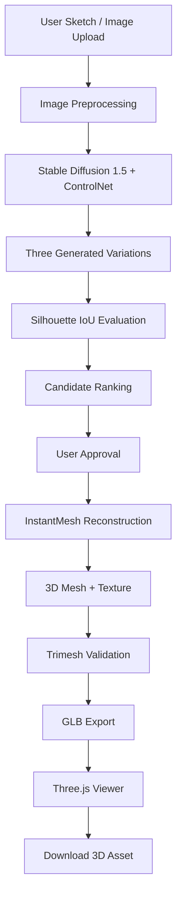

# ✦ PoofIt3D
### From a 2D Sketch to a Textured 3D Creation

<p align="center">
  <strong>Draw. Enhance. Evaluate. Reconstruct. Explore.</strong>
</p>

<p align="center">
  
  
  
  
</p>

<p align="center">
  **Team Sirius**  
  K. Akash · Kavish Bhatia · Keerthi H.
</p>

---

## 01 · The Vision

**What if creating a 3D object started with nothing more than a simple sketch?**

Traditional 3D modelling often requires specialised software, technical experience, and considerable manual effort. PoofIt3D explores a different approach: transforming a user's initial drawing into a textured, downloadable 3D asset through an integrated AI pipeline.

PoofIt3D combines:

- Sketch-conditioned image generation.
- Silhouette-based sketch-fidelity evaluation.
- Human-in-the-loop candidate approval.
- AI-powered image-to-3D reconstruction.
- Mesh validation and GLB export.

**Our goal:** Preserve the intent behind the original sketch while making 3D creation more accessible.

## 02 · The Experience

| Step | Process |
|---|---|
| 01 · Sketch | Draw on the interactive canvas or upload an image. |
| 02 · Enhance | Generate three sketch-guided visual variations. |
| 03 · Evaluate | Compare candidate silhouettes using Intersection over Union (IoU). |
| 04 · Approve | Select the visual interpretation that best represents the concept. |
| 05 · Reconstruct | Convert the approved image into a 3D mesh using InstantMesh. |
| 06 · Explore | Inspect the reconstructed object in an interactive viewer. |
| 07 · Export | Download the textured 3D asset in GLB format. |

## 03 · Project Gallery

### Sketch-to-image results

The project evaluation includes four sketch categories:

- Racecar
- Person
- Camel
- House

### Reconstructed 3D assets

Four objects were successfully reconstructed and exported as textured GLB models.

| Object | Vertices | Faces | GLB size | 3D generation time |
|---|---:|---:|---:|---:|
| Racecar | 10,453 | 14,336 | 1.13 MB | 88.51 s |
| Camel | 7,406 | 10,616 | 1.23 MB | 72.70 s |
| Person | 8,049 | 12,068 | 1.19 MB | 71.20 s |
| House | 19,901 | 28,420 | 1.89 MB | 77.00 s |

<details>
<summary><strong>Explore exported 3D models</strong></summary>

- Racecar — `racecar.glb`
- Camel — `camel.glb`
- Person — `person.glb`
- House — `house.glb`

The models can be inspected using an online glTF viewer or Blender.

</details>

<sub>Recorded environment: NVIDIA Tesla T4 GPU · InstantMesh Large · grid_res=64. Times refer to 3D reconstruction, not the complete workflow.</sub>

## 04 · System Architecture

PoofIt3D uses two primary generative stages, connected by a quality-evaluation and user-approval layer.



### Stage 1 — Sketch-conditioned image generation

**Stable Diffusion 1.5 + ControlNet-Scribble**

ControlNet uses the input sketch as a structural conditioning signal, helping the diffusion model follow the original drawing while generating visual details such as colour, material and appearance.

Key capabilities:

- Sketch-guided image generation.
- Optional natural-language prompts.
- Image preprocessing and background handling.
- Three candidate variations.
- Generation progress tracking.

### Stage 2 — Sketch-fidelity evaluation

**NumPy + OpenCV + Silhouette IoU**

A visually attractive result is not necessarily a faithful interpretation of the original drawing.

PoofIt3D uses silhouette Intersection over Union (IoU) to compare the original sketch outline with the foreground silhouette of each generated candidate.

The evaluation process:

1. Extract the original sketch silhouette.
2. Segment the generated image foreground.
3. Normalise both silhouettes.
4. Calculate their intersection and union.
5. Rank candidates based on silhouette overlap.

The mathematical definition:

\[
IoU(A,B)=\frac{|A\cap B|}{|A\cup B|}
\]

Where:

- A represents the original sketch silhouette.
- B represents the generated image silhouette.

A higher IoU indicates greater outline overlap.

**Why it matters:** This introduces an explainable geometric comparison instead of relying exclusively on subjective visual selection.

*IoU evaluates silhouette similarity. It does not independently establish semantic correctness, texture quality or complete 3D accuracy.*

### Stage 3 — Image-to-3D reconstruction

**TencentARC InstantMesh**

After the user approves a generated image, the selected concept enters the 3D reconstruction stage.

The documented reconstruction workflow includes:

- Background removal.
- Zero123++ multi-view generation.
- Large Reconstruction Model (LRM).
- FlexiCubes mesh extraction.
- Texture-map generation.

The result is a textured 3D mesh intended for interactive inspection and export.

### Stage 4 — Validation and export

**Trimesh + GLB**

The exported model is reloaded for validation.

Validation checks include:

- Non-empty geometry.
- Vertex and face counts.
- Embedded texture information.
- Successful model export and reload.

The resulting GLB asset can be inspected in the Three.js viewer and downloaded.

## 05 · Technology Stack

| Layer | Technology |
|---|---|
| Frontend | React 18, TypeScript |
| Drawing interface | Excalidraw |
| 2D image generation | Stable Diffusion 1.5 |
| Sketch conditioning | ControlNet-Scribble |
| Image processing | NumPy, OpenCV |
| Fidelity evaluation | Silhouette IoU |
| 3D reconstruction | TencentARC InstantMesh |
| Multi-view generation | Zero123++ |
| Mesh extraction | FlexiCubes |
| Mesh validation | Trimesh |
| Backend | Python, FastAPI |
| Communication | REST API, Server-Sent Events |
| 3D visualisation | Three.js |
| GPU acceleration | NVIDIA CUDA |

## 06 · Engineering Decisions

| Decision | Engineering rationale |
|---|---|
| ControlNet conditioning | Helps preserve the input sketch's structure during image generation. |
| Three candidate outputs | Gives users multiple visual interpretations. |
| Silhouette IoU | Provides a lightweight and explainable geometric comparison. |
| Manual approval | Keeps users in control before expensive reconstruction. |
| Separate 3D environment | Isolates InstantMesh dependencies from the image-generation environment. |
| GLB validation | Checks the exported asset before delivery. |

## 07 · Experimental Results

The documented evaluation covers four different sketch categories: racecar, camel, person and house.

| Evaluation dimension | Implementation |
|---|---|
| Sketch input | Interactive canvas and image upload |
| Image preprocessing | EXIF correction, transparency handling, grayscale conversion and resizing |
| Image generation | ControlNet-Scribble |
| Candidate generation | Three variations |
| Quality evaluation | Silhouette IoU |
| Human control | Manual candidate approval |
| 3D reconstruction | InstantMesh |
| Mesh processing | Textured mesh extraction |
| Validation | Trimesh reload and geometry checks |
| Final output | Downloadable GLB |

### Hardware environment

- GPU: NVIDIA Tesla T4.
- Reconstruction model: InstantMesh Large.
- Reconstruction configuration: `grid_res=64`.

The reported values are individual recorded runs, not statistically averaged performance guarantees.

## 08 · Getting Started

### Option A — Full pipeline with Kaggle GPU

The documented end-to-end workflow uses a Kaggle NVIDIA Tesla T4 GPU environment.

**Requirements**

- Kaggle account with GPU access.
- GPU T4 accelerator.
- Internet enabled for initial model downloads.
- Project files uploaded as a Kaggle dataset.
- PoofIt3D end-to-end notebook.

**Execution workflow**

1. Upload the project ZIP as a Kaggle dataset.
2. Open `PoofIt3D_Kaggle_E2E.ipynb`.
3. Attach the uploaded dataset.
4. Select the GPU T4 accelerator.
5. Enable Internet.
6. Execute the notebook cells in sequence.
7. Download the generated `results.zip`.

### Option B — Local development

**Prerequisites**

- Python 3.12.
- Node.js and npm.
- Git.
- Compatible PyTorch/CUDA installation for GPU acceleration.

Clone the repository:

```bash
git clone YOUR_REPOSITORY_URL
cd PoofIt3D
```

**Backend**

```bash
cd backend
python -m venv .venv
```

Windows PowerShell:

```powershell
.\.venv\Scripts\Activate.ps1
```

Install dependencies:

```bash
pip install -r requirements.txt
```

Start the backend using the configured entry point:

```bash
python main.py
```

**Frontend**

Open another terminal:

```bash
cd frontend
npm install
npm start
```

Open the application:

```text
http://localhost:3000
```

The frontend and backend must both be configured to communicate with each other. The 3D reconstruction stage additionally requires the separately configured InstantMesh environment and compatible GPU resources.

See `docs/3d-setup.md` for the 3D environment configuration.

## 09 · Backend API

The documented backend interface includes:

| Method | Endpoint | Purpose |
|---|---|---|
| GET | `/api/health` | Backend and GPU health |
| GET | `/api/models` | Available image-generation models |
| POST | `/api/generate` | Submit a sketch for image generation |
| GET | `/api/progress/{id}` | Retrieve generation progress |
| GET | `/api/status/{id}` | Retrieve generation status and metadata |
| GET | `/api/images/{id}` | Retrieve generated images |
| POST | `/api/3d/generate` | Start 3D reconstruction |
| GET | `/api/share/{id}` | Share result, where configured |

Refer to the actual backend route definitions for authoritative request and response schemas.

## 10 · Repository Structure

```text
PoofIt3D/
│
├── backend/
│   ├── main.py
│   ├── app/
│   │   ├── api/
│   │   ├── core/
│   │   ├── models/
│   │   └── services/
│   │       ├── generation.py
│   │       ├── quality.py
│   │       ├── three_d.py
│   │       └── progress_tracker.py
│   ├── config/
│   ├── run_e2e.py
│   └── requirements.txt
│
├── frontend/
│   └── src/
│       └── components/
│
├── docs/
│   ├── images/
│   ├── results/
│   └── 3d-setup.md
│
├── scripts/
├── PoofIt3D_Kaggle_E2E.ipynb
├── NOTICE.md
└── README.md
```

## 11 · Project Resources

**GitHub Repository**

**Google Drive — Complete Project Files**

**Kaggle — Dataset and Execution Notebook**

**Project Demonstration Video**

**Project Presentation**

**Technical Documentation**

## 12 · Limitations and Future Scope

### Current limitations

- A single 2D image does not contain complete information about hidden geometry; the reconstruction model must infer unseen surfaces.
- Thin structures and complex mechanical details may not reconstruct perfectly.
- Silhouette IoU measures outline overlap, not semantic accuracy or full 3D fidelity.
- Reconstruction quality depends on image clarity, object isolation and the original sketch.
- The documented T4 configuration uses `grid_res=64` to fit available GPU memory.
- Generated models are intended for visualisation and concept exploration, not guaranteed manufacturing or 3D-printing accuracy.

### Future development

- Improved multi-view consistency.
- Higher-resolution mesh and texture generation.
- Better handling of complex and overlapping sketches.
- Geometry-aware quality evaluation.
- Additional 3D export formats.
- Faster inference and improved GPU memory utilisation.
- More advanced 3D editing and interaction.

## 13 · Models and Acknowledgements

PoofIt3D builds upon open-source research and development projects.

| Technology | Reference |
|---|---|
| Stable Diffusion 1.5 | [Hugging Face Model](https://huggingface.co/stable-diffusion-v1-5/stable-diffusion-v1-5) |
| ControlNet-Scribble | [Hugging Face Model](https://huggingface.co/lllyasviel/sd-controlnet-scribble) |
| InstantMesh | [TencentARC/InstantMesh](https://github.com/TencentARC/InstantMesh) |
| nvdiffrast | [NVIDIA/nvdiffrast](https://github.com/NVlabs/nvdiffrast) |
| Trimesh | [Official Documentation](https://trimesh.org/) |
| Three.js | [Official Website](https://threejs.org/) |
| FastAPI | [Official Documentation](https://fastapi.tiangolo.com/) |

Refer to the respective upstream projects and `NOTICE.md` for licensing and attribution details.

## 14 · Team Sirius

**Built with curiosity, creativity and code.**

| Team member |
|---|
| K. Akash |
| Kavish Bhatia |
| Keerthi H. |

**Event:** TechZephyr 4.0  
**Institution:** CMR University  
**Venue:** IIT Bhubaneswar

---

<p align="center">
  **PoofIt3D**
  
  *Every great creation begins with a sketch.*
  
  From imagination to a 3D world.
  
  **Team Sirius · TechZephyr 4.0**
</p>
