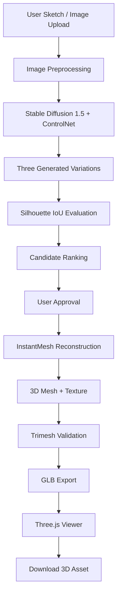

# ✦ PoofIt3D
### From a 2D Sketch to a Textured 3D Creation

<p align="center">
  <strong>Draw. Enhance. Evaluate. Reconstruct. Explore.</strong>
</p>

<p align="center">
  
  
  
  
</p>

<p align="center">
  <strong>Team Sirius</strong><br>
  K. Akash · Kavish Bhatia · Keerthi H.
</p>

---

## 01 · The Vision

**What if creating a 3D object started with nothing more than a simple sketch?**

Traditional 3D modelling needs specialised software, technical experience and a lot of manual effort. PoofIt3D turns a user's initial drawing into a textured, downloadable 3D asset through one integrated AI pipeline.

PoofIt3D combines:

- Sketch-conditioned image generation.
- Silhouette-based sketch-fidelity evaluation.
- Human-in-the-loop candidate approval.
- AI-powered image-to-3D reconstruction.
- Mesh validation and GLB export.

**Our goal:** preserve the intent behind the original sketch while making 3D creation accessible to anyone.

## 02 · The Experience

| Step | Process |
|---|---|
| 01 · Sketch | Draw on the interactive canvas (brush, eraser, reset) or upload an image. |
| 02 · Enhance | Generate three sketch-guided visual variations. An optional text prompt steers colour, material and style. |
| 03 · Evaluate | Each candidate's silhouette is compared with the sketch using Intersection over Union (IoU). |
| 04 · Approve | Select the visual interpretation that best represents the concept. |
| 05 · Reconstruct | Convert the approved image into a 3D mesh with InstantMesh. |
| 06 · Explore | Inspect the object in an interactive Three.js viewer. |
| 07 · Export | Download the textured 3D asset as a GLB file. |

## 03 · Project Gallery

### Sketch-to-image results

Each row shows the **hand-drawn sketch** followed by **three generated variations**.

**Racecar**


**Person**


**Camel**


A fourth sketch, **House**, was also reconstructed; its model is listed below.

### Reconstructed 3D assets

All four objects were reconstructed and exported as textured GLB models. Every file was reloaded after export and its vertex and face counts were checked against this table.

| Object | Vertices | Faces | GLB size | 3D generation time |
|---|---:|---:|---:|---:|
| Racecar | 10,453 | 14,336 | 1.13 MB | 88.51 s |
| Camel | 7,406 | 10,616 | 1.23 MB | 72.70 s |
| Person | 8,049 | 12,068 | 1.19 MB | 71.20 s |
| House | 19,901 | 28,420 | 1.89 MB | 77.00 s |

<details>
<summary><strong>Explore the exported 3D models</strong></summary>

- Racecar — [`racecar.glb`](docs/results/racecar.glb)
- Camel — [`camel.glb`](docs/results/camel.glb)
- Person — [`person.glb`](docs/results/person.glb)
- House — [`house.glb`](docs/results/house.glb)

Open any file in an online glTF viewer such as <https://gltf-viewer.donmccurdy.com>, or in Blender (*File → Import → glTF 2.0*).

</details>

<sub>Recorded environment: NVIDIA Tesla T4 GPU · InstantMesh Large · grid_res=64. The times above refer to 3D reconstruction only, not the complete workflow.</sub>

## 04 · System Architecture

PoofIt3D uses two generative stages, connected by a quality-evaluation and user-approval layer.



### Stage 1 — Sketch-conditioned image generation

**Stable Diffusion 1.5 + ControlNet-Scribble**

ControlNet uses the input sketch as a structural signal, so the diffusion model follows the original drawing while adding colour, material and appearance.

- Sketch-guided image generation with an optional natural-language prompt.
- Preprocessing: EXIF correction, transparency flattening, grayscale conversion, stroke inversion, aspect-preserving resize.
- Every request also asks for a single, centred object on a plain background, which helps both evaluation and reconstruction.
- Three candidate variations with live progress streaming.

### Stage 2 — Sketch-fidelity evaluation

**NumPy + OpenCV + Silhouette IoU**

A visually attractive result is not necessarily a faithful interpretation of the drawing. PoofIt3D compares the sketch outline with the foreground silhouette of each candidate:

1. Extract and fill the original sketch silhouette.
2. Segment the generated image's foreground.
3. Crop both to their bounding boxes and normalise them to the same size.
4. Calculate their intersection and union.
5. Rank the candidates by overlap. The best one is pre-selected in the UI and every thumbnail shows its fidelity score.

$$IoU(A,B)=\frac{|A\cap B|}{|A\cup B|}$$

where *A* is the sketch silhouette and *B* is the generated image silhouette. A higher IoU means greater outline overlap.

**Why it matters:** it replaces a purely subjective choice with an explainable geometric comparison, and it needs no extra model weights (CPU only, milliseconds per image).

*IoU evaluates silhouette similarity only. It does not establish semantic correctness, texture quality or complete 3D accuracy.*

### Stage 3 — Image-to-3D reconstruction

**TencentARC InstantMesh**

After the user approves an image, InstantMesh runs in its own isolated environment:

- Background removal.
- Zero123++ multi-view generation.
- Large Reconstruction Model (LRM).
- FlexiCubes mesh extraction.
- Texture-map generation.

### Stage 4 — Validation and export

**Trimesh + GLB**

The exported model is reloaded and checked for:

- Non-empty geometry.
- Vertex and face counts.
- Embedded texture information.
- Successful export and reload.

The validated GLB can be inspected in the Three.js viewer (orbit, zoom, pan, reset) and downloaded.

## 05 · Technology Stack

| Layer | Technology |
|---|---|
| Frontend | React 18, TypeScript |
| Drawing interface | Excalidraw |
| 2D image generation | Stable Diffusion 1.5 |
| Sketch conditioning | ControlNet-Scribble |
| Image processing | NumPy, OpenCV |
| Fidelity evaluation | Silhouette IoU |
| 3D reconstruction | TencentARC InstantMesh |
| Multi-view generation | Zero123++ |
| Mesh extraction | FlexiCubes |
| Mesh validation | Trimesh |
| Backend | Python, FastAPI |
| Communication | REST API, Server-Sent Events |
| 3D visualisation | Three.js |
| GPU acceleration | NVIDIA CUDA |

## 06 · Engineering Decisions

| Decision | Engineering rationale |
|---|---|
| ControlNet conditioning | Preserves the input sketch's structure during image generation. |
| Three candidate outputs | Gives users several visual interpretations to choose from. |
| Silhouette IoU | A lightweight, explainable geometric comparison with no extra model. |
| Manual approval | Keeps the user in control before the expensive reconstruction step. |
| Separate 3D environment | Isolates InstantMesh's pinned dependencies from the image-generation stack. |
| GLB validation | Checks the exported asset before it is delivered. |

## 07 · Hardware, Runtime and Pipeline Coverage

### Hardware environment

| Item | Value |
|---|---|
| GPU | NVIDIA Tesla T4, 16 GB VRAM (Kaggle) |
| Reconstruction model | InstantMesh Large, `grid_res=64` |
| 2D stage (3 variations, 20 steps, 768²) | about 121 s (one recorded run) |
| 3D stage | 71–89 s per model (see table above) |
| First-run setup | about 15 GB of model weights, downloaded once |
| Minimum for the full pipeline | one NVIDIA GPU with 16 GB VRAM, 16 GB RAM, about 30 GB disk |

Without a GPU the 2D stage runs very slowly on CPU, and the 3D stage cannot run because InstantMesh requires CUDA. The reported values are individual recorded runs, not statistically averaged performance guarantees.

### Pipeline coverage

| Dimension | Implementation |
|---|---|
| Sketch input | Interactive canvas and image upload (PNG, JPG, WEBP) |
| Image preprocessing | EXIF correction, transparency handling, grayscale conversion, resizing |
| Image generation | ControlNet-Scribble |
| Candidate generation | Three variations |
| Quality evaluation | Silhouette IoU |
| Human control | Manual candidate approval |
| 3D reconstruction | InstantMesh |
| Validation | Trimesh reload and geometry checks |
| Final output | Downloadable textured GLB |

## 08 · Getting Started

### Option A — Full pipeline on a Kaggle GPU (recommended)

**Requirements:** a Kaggle account with a verified phone number (needed for GPU and Internet), the project uploaded as a Kaggle dataset, and `PoofIt3D_Kaggle_E2E.ipynb`.

1. Upload the project ZIP as a Kaggle dataset.
2. Import `PoofIt3D_Kaggle_E2E.ipynb` into a new notebook and attach the dataset.
3. Select the **GPU T4** accelerator and enable **Internet**.
4. Run the cells in order. The InstantMesh setup cell ends with `InstantMesh env OK`, followed by `weights ready`.
5. Download the generated `results.zip` (images, GLB files and a results summary).

### Option B — Local development

**Prerequisites:** Python 3.12, Node.js and npm, Git, and a CUDA-enabled PyTorch installation for GPU acceleration.

```bash
git clone https://github.com/kakashsunny/PoofIt3D.git
cd PoofIt3D
```

**Backend**

```bash
cd backend
python -m venv .venv
source .venv/bin/activate            # Windows PowerShell: .\.venv\Scripts\Activate.ps1
cp .env.example .env
pip install -r requirements.txt -r requirements-3d.txt
uvicorn main:app --host 0.0.0.0 --port 8000
```

**Frontend** (in a second terminal)

```bash
cd frontend
npm install
npm start
```

Open `http://localhost:3000`. The 3D stage additionally needs the separate InstantMesh environment: set `INSTANTMESH_DIR` and `INSTANTMESH_PYTHON` in `backend/.env`. See [`docs/3d-setup.md`](docs/3d-setup.md) for the exact steps.

### Option C — Command line (no UI)

With the backend running:

```bash
python backend/run_e2e.py --sketch my_sketch.png --prompt "wooden chair, walnut finish" --out out/
python backend/run_e2e.py --out results/        # all bundled test sketches
python backend/test_quality.py                  # sanity check of the IoU scorer
```

Docker Compose files and Kubernetes manifests are also provided (`docker-compose.yml`, `kubernetes/`).

## 09 · Backend API

| Method | Endpoint | Purpose |
|---|---|---|
| GET | `/api/health` | Backend and GPU health |
| GET | `/api/models` | Available image-generation models |
| POST | `/api/generate` | Submit a sketch for image generation |
| GET | `/api/progress/{id}` | Server-Sent Events progress stream |
| GET | `/api/status/{id}` | Generation status, fidelity scores and timing |
| GET | `/api/images/{id}` | Retrieve generated images |
| POST | `/api/3d/generate` | Start 3D reconstruction and GLB export |
| GET | `/api/share/{id}` | Share a result |

Refer to `backend/app/api/routes.py` for the authoritative request and response schemas.

## 10 · Troubleshooting

| Symptom | Cause and fix |
|---|---|
| `POST /api/3d/generate` returns 503 | The InstantMesh environment was not found. Check `INSTANTMESH_DIR` and `INSTANTMESH_PYTHON`, and that the setup cell printed `InstantMesh env OK`. |
| `nvdiffrast` fails to build | Build it against the installed PyTorch with `--no-build-isolation` and `CUDA_HOME` set (the notebook does this). |
| NumPy 2.x import errors in the InstantMesh env | PyTorch 2.1 needs NumPy 1.x: use `numpy==1.26.4`. |
| `huggingface_hub` resolver conflict | Use `huggingface_hub==0.17.3` inside the InstantMesh env. |
| Out of GPU memory | Keep `grid_res: 64`, stop other GPU jobs and restart the runtime. |
| Progress bar never moves | The API is not reachable from the browser. Check the proxy, `REACT_APP_API_URL` and `/api/health`. |
| `Repository not found` for Stable Diffusion 1.5 | The old `runwayml/…` repo was removed; use `stable-diffusion-v1-5/stable-diffusion-v1-5`. |
| Messy 3D model | Try another variation. A single centred object on a plain background reconstructs best. |

## 11 · Repository Structure

```text
PoofIt3D/
│
├── backend/
│   ├── main.py
│   ├── app/
│   │   ├── api/                  # REST + SSE routes
│   │   ├── core/                 # settings, model registry
│   │   ├── models/               # response schemas
│   │   └── services/
│   │       ├── generation.py     # preprocessing + ControlNet generation
│   │       ├── quality.py        # silhouette-IoU scoring
│   │       ├── three_d.py        # InstantMesh adapter, GLB validation
│   │       └── progress_tracker.py
│   ├── config/                   # InstantMesh T4 configuration
│   ├── test_sketches/
│   ├── run_e2e.py
│   ├── test_quality.py
│   └── requirements.txt, requirements-3d.txt, .env.example
│
├── frontend/
│   └── src/components/
│
├── proxy-server/
├── kubernetes/
├── scripts/
├── docs/
│   ├── images/
│   ├── results/                  # result grids and GLB models
│   └── 3d-setup.md
│
├── docker-compose.yml
├── PoofIt3D_Kaggle_E2E.ipynb
├── NOTICE.md
├── VALIDATION_REPORT.md
└── README.md
```

## 12 · Project Resources

- **GitHub Repository:** [kakashsunny/PoofIt3D](https://github.com/kakashsunny/PoofIt3D)
- **Google Drive, complete project files:** [add link](ADD_LINK)
- **Kaggle, dataset and execution notebook:** [add link](ADD_LINK)
- **Project demonstration video:** [add link](ADD_LINK)
- **Project presentation:** [add link](ADD_LINK)
- **Technical documentation:** [add link](ADD_LINK)

## 13 · Limitations and Future Scope

### Current limitations

- A single 2D image does not contain complete information about hidden geometry; the reconstruction model must infer unseen surfaces.
- Thin structures and complex mechanical details may not reconstruct perfectly.
- Some generated images still contain scenery despite the plain-background instruction (for example the racecar above). This makes segmentation harder and lowers the fidelity score.
- Silhouette IoU measures outline overlap, not semantic accuracy or full 3D fidelity.
- Reconstruction quality depends on image clarity, object isolation and the original sketch.
- The T4 configuration uses `grid_res=64` to fit available GPU memory, so surfaces are coarse.
- Models are intended for visualisation and concept exploration, not manufacturing or 3D-printing accuracy.

### Future development

- Improved multi-view consistency.
- Higher-resolution mesh and texture generation.
- Automatic background cleanup before reconstruction.
- Better handling of complex and overlapping sketches.
- Geometry-aware quality evaluation.
- Additional 3D export formats.
- Faster inference and better GPU memory use.

## 14 · Models and Acknowledgements

PoofIt3D builds on open-source research and development. All models are pretrained and used as-is, with no fine-tuning. Weights are downloaded from the Hugging Face Hub, and no paid API is required.

| Technology | Reference |
|---|---|
| Stable Diffusion 1.5 | [Hugging Face Model](https://huggingface.co/stable-diffusion-v1-5/stable-diffusion-v1-5) |
| ControlNet-Scribble | [Hugging Face Model](https://huggingface.co/lllyasviel/sd-controlnet-scribble) |
| InstantMesh (Zero123++, LRM, FlexiCubes) | [TencentARC/InstantMesh](https://github.com/TencentARC/InstantMesh) |
| nvdiffrast | [NVlabs/nvdiffrast](https://github.com/NVlabs/nvdiffrast) |
| Trimesh | [Official Documentation](https://trimesh.org/) |
| Three.js | [Official Website](https://threejs.org/) |
| FastAPI | [Official Documentation](https://fastapi.tiangolo.com/) |

Refer to the respective upstream projects and [`NOTICE.md`](NOTICE.md) for licensing and attribution details.

## 15 · Team Sirius

**Built with curiosity, creativity and code.**

| Team member |
|---|
| K. Akash |
| Kavish Bhatia |
| Keerthi H. |

**Event:** TechZephyr 4.0  
**Institution:** CMR University  
**Venue:** IIT Bhubaneswar

---

<p align="center">
  <strong>PoofIt3D</strong><br>
  <em>Every great creation begins with a sketch.</em><br>
  From imagination to a 3D world.<br>
  <strong>Team Sirius · TechZephyr 4.0</strong>
</p>
