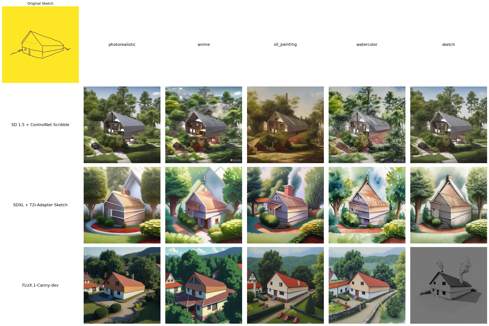

# PoofIt3D — Sketch2Shape (TechZephyr 4.0)

Single 2D sketch (drawn in-app or uploaded) → refined product image → **textured 3D mesh (.glb)** with an interactive viewer.



## What it does
1. **Input** – Excalidraw drawing canvas (brush, eraser, undo, reset) or drag-and-drop upload (PNG/JPG/WEBP ≤ 12 MB). Text prompt is optional, never required.
2. **Preprocess** – EXIF fix, alpha→white flatten, grayscale, invert to white-on-black strokes, aspect-preserving resize to 768².
3. **Sketch-guided generation** – Stable Diffusion 1.5 + ControlNet-Scribble (default, fits a T4) or SDXL + T2I-Adapter-Sketch. Produces **3 variations**.
4. **Quality layer (best-of-N)** – each variation is scored against the sketch by *silhouette IoU* (`backend/app/services/quality.py`): the sketch is filled into a silhouette, the output foreground is segmented, both are bbox-normalised, IoU is computed. The best variation is pre-selected and each thumbnail shows its fidelity %. CPU-only, no extra weights.
5. **Approve** – the user approves a variation before the expensive 3D step.
6. **Image→3D** – TencentARC **InstantMesh** (large) in an isolated Python 3.10 env; `rembg` background removal runs inside InstantMesh; a textured OBJ is exported.
7. **Validation + export** – `trimesh` reloads the mesh, rejects empty geometry or a missing texture, converts to **.glb**, reloads the .glb and re-checks vertices, faces and embedded texture before offering the download. Three.js viewer: orbit / zoom / pan / reset.

```
Sketch → preprocess → SD1.5+ControlNet → 3 variations → silhouette-IoU rank → user approves
      → InstantMesh (rembg → multiview diffusion → LRM → FlexiCubes) → OBJ+texture → trimesh validate → GLB → viewer / download
React + Excalidraw + Three.js ⇄ (SSE progress) ⇄ FastAPI (backend/) · InstantMesh runs as a subprocess in its own venv
```

## Hardware assumptions
| | Minimum | Target used |
|---|---|---|
| GPU | NVIDIA **16 GB VRAM** (T4) | Kaggle / Colab T4 |
| RAM / disk | 16 GB / 30 GB (weights ≈ 15 GB) | |
| OS | Linux, CUDA 12.1 | Ubuntu 22.04 |

No GPU → the 2D stage runs on CPU (slow); InstantMesh **requires** CUDA. A 4 GB laptop GPU cannot run the 3D stage.

## Reproduce (recommended: Kaggle, ≈20 min setup)
1. Kaggle → New Notebook → Settings: **GPU T4**, **Internet On**. Add this repo's zip as a dataset.
2. Open `PoofIt3D_Kaggle_E2E.ipynb` → **Run All**. It installs dependencies, clones InstantMesh, downloads weights, starts the API and runs the 5 bundled sketches end-to-end.
3. Outputs: `results/<name>_grid.png`, `<name>.glb`, `results.json`, **`RESULTS.md`** (timings + hardware). Copy them into `docs/results/` and paste the table below.

### Run the web UI
```bash
cd backend && cp .env.example .env
pip install -r requirements.txt -r requirements-3d.txt      # torch (CUDA) must already be installed
# InstantMesh env (separate): see notebook cell 4 for exact commands; then set INSTANTMESH_* in .env
uvicorn main:app --host 0.0.0.0 --port 8000
cd ../frontend && npm install && npm start                  # http://localhost:3000 (proxies /api → :8000)
# remote GPU:  REACT_APP_API_URL=https://<tunnel>/api npm run build
```
`.env`: `INSTANTMESH_DIR`, `INSTANTMESH_PYTHON`, `INSTANTMESH_CONFIG` (default: T4-safe `grid_res=64`), `INSTANTMESH_TIMEOUT`, `DEVICE`.

### Command line
```bash
python backend/run_e2e.py --sketch my.png --prompt "wooden chair, walnut" --out out/   # API running
python backend/run_e2e.py --no3d                                                       # 2D stage only
python backend/test_quality.py                                                         # unit check of the IoU scorer
```

## Measured results
Generated by `run_e2e.py`; hardware is recorded in `docs/results/RESULTS.md`.

First measured data point (Kaggle Tesla T4, SD1.5 + ControlNet, 20 steps × 3 variations, 768²): **≈121 s** for the 2D stage.

| Sketch | 2D enhance (s) | 3D reconstruct (s) | Fidelity IoU | Vertices | Faces |
|---|---|---|---|---|---|
| _populate by running the notebook_ | | | | | |

## Models & attribution (pretrained, not fine-tuned)
| Component | Source | License |
|---|---|---|
| Stable Diffusion 1.5 | `stable-diffusion-v1-5/stable-diffusion-v1-5` | CreativeML OpenRAIL-M |
| ControlNet Scribble | `lllyasviel/sd-controlnet-scribble` | CreativeML OpenRAIL-M |
| SDXL base, T2I-Adapter sketch, fp16 VAE | `stabilityai/stable-diffusion-xl-base-1.0`, `TencentARC/t2i-adapter-sketch-sdxl-1.0`, `madebyollin/sdxl-vae-fp16-fix` | OpenRAIL++ / Apache-2.0 / MIT |
| InstantMesh (+ Zero123++, DINO, rembg) | `TencentARC/InstantMesh` | Apache-2.0 |
| Excalidraw, Three.js, FastAPI, Diffusers, trimesh, OpenCV | open source | MIT / Apache-2.0 |

External services: Hugging Face Hub (weight download only). No paid API.

## Limitations
- Single view ⇒ hidden geometry is inferred, not recovered; thin parts and text may be wrong.
- T4 config uses `grid_res=64` (coarse surfaces); raise it in `config/instant-mesh-large-t4.yaml` on ≥24 GB GPUs.
- Fidelity IoU measures outline match only; it needs a mostly closed sketch outline and a plain background in the output, and ignores texture/semantics. Validated on synthetic shapes; see Measured results for real-sketch behaviour.
- One 3D job at a time (GPU lock). First run downloads ≈15 GB of weights.
- SDXL option needs ≈10–12 GB VRAM and is slower. FLUX was removed (gated, too large for T4).

## Troubleshooting
| Symptom | Fix |
|---|---|
| `InstantMesh checkout is missing` | set `INSTANTMESH_DIR`; clone TencentARC/InstantMesh |
| `ran out of T4 GPU memory` | keep `grid_res: 64`, stop other GPU jobs, restart runtime |
| No progress bar in UI | API unreachable; check proxy / `REACT_APP_API_URL` / port 8000 |
| SD1.5 `Repository not found` | use `stable-diffusion-v1-5/stable-diffusion-v1-5` (default) |
| `npm ci` lockfile error | run `npm install` |
